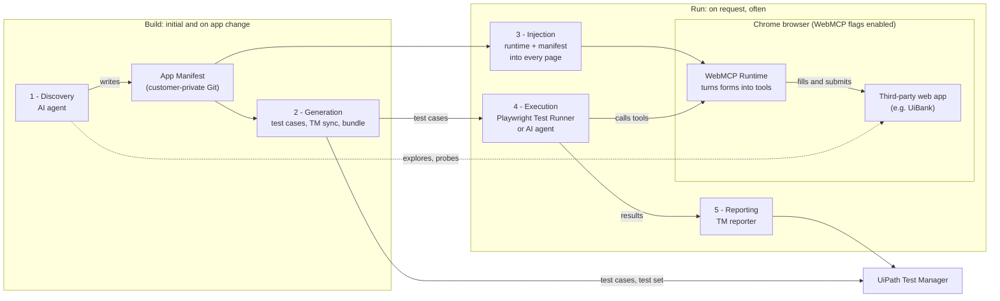
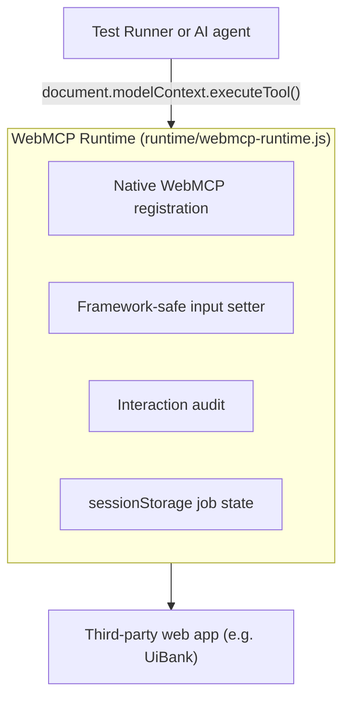

# WebMCP Adapter

A lightweight adapter system demonstrating how to inject WebMCP-ready tools into third-party web applications (which do not natively support WebMCP) and use them for automated testing and autonomous AI agents.

This project connects modern browser capabilities (Chrome's native WebMCP API), automated test orchestration ([Playwright](https://playwright.dev/)), and enterprise test management ([UiPath Test Manager](https://www.uipath.com/product/test-manager)) without requiring Windows VMs, UiPath Studio desktop installations, or traditional UiPath Object Repositories.

---

## Table of Contents

- [Overview](#overview)
- [Two Lifecycles: Build and Run](#two-lifecycles-build-and-run)
- [Build (initial and on app change)](#build-initial-and-on-app-change)
  - [1. Discovery](#1-discovery)
  - [2. Generation](#2-generation)
- [Run (on request, often)](#run-on-request-often)
  - [3. Injection](#3-injection)
  - [4. Execution](#4-execution)
  - [5. Reporting](#5-reporting)
- [The Playwright Project Scope](#the-playwright-project-scope)
- [Prerequisites & Environment](#prerequisites--environment)
- [Command Reference](#command-reference)
- [To Do](#to-do)

## Documentation

| Document | Content |
|---|---|
| [docs/repository-structure.md](docs/repository-structure.md) | What each folder contains |
| [docs/discovery.md](docs/discovery.md) | Discovery phase: DOM scan, outcome probes, manifest synthesis |
| [docs/form-filling-internals.md](docs/form-filling-internals.md) | How the injected runtime fills forms (native setter, event cascade, audit) |
| [docs/webmcp-evidence.md](docs/webmcp-evidence.md) | Screenshots: DevTools WebMCP panel, tools panel, agent runs, audit |
| [docs/webmcp-research.md](docs/webmcp-research.md) | WebMCP primer: MCP recap, how it works, status, outlook, risks, competing technologies |
| [docs/webmcp-intro-slides.md](docs/webmcp-intro-slides.md) | Presenter notes: the WebMCP intro slides in DarkTestingFactory.pptx and what changed |

---

## Overview

Third-party web applications rarely expose structured, machine-callable interfaces for AI agents or test runners. Traditional browser automation relies on fragile DOM selectors spread across test scripts, which break often and fit badly into agentic workflows.

The idea: we don't wait for the app vendor to offer WebMCP. We **inject** a small script into the app's pages that turns its forms into WebMCP tools - named, described, callable functions such as `applyForLoan(amount, term, income, age)`. The browser registers them like tools the app had published itself. From then on, a test or an AI agent says *what* it wants and the tool does the clicking and typing.

This rests on two layers:

1. **WebMCP Runtime** ([runtime/webmcp-runtime.js](runtime/webmcp-runtime.js)) - written once, works on any web app. It reads a manifest, registers its tools with the browser and executes them. How it works inside: [What the injected runtime does](#what-the-injected-runtime-does).
2. **App Manifest** ([manifests/uibank.manifest.json](manifests/uibank.manifest.json)) - one per app, generated by an AI agent rather than written by hand. It describes the app's pages, forms, fields, tools and business rules. It replaces the UiPath Object Repository with a web-native JSON file versioned in Git. Manifests contain customer knowledge (selectors, internal URLs, business rules), so in real use they belong in a **customer-private Git repository, separate from the webmcp-adapter source code** - the UiBank manifest sits in this repo only because UiBank is a public demo app. See To Do: [Secure Manifest Registry](#todo-manifest-registry) and [Manifest in Test Manager requirements](#todo-manifest-tm).

> [!NOTE]
> The **WebMCP Runtime** is our own script, not a built-in browser feature. The browser is standard Google Chrome or Playwright's Chromium with the WebMCP experimental flags enabled (see [Prerequisites & Environment](#prerequisites--environment)).

---

## Two Lifecycles: Build and Run

The five phases fall into two lifecycles that run at different times. **Build** turns an unknown app into ready-to-use tools and tests - it discovers the app, writes the manifest and generates the test cases. **Run** uses what Build produced.



| | Build | Run |
|---|---|---|
| **When** | Once per app, again when the app changes | On request - every test run or agent task, many times a day |
| **Phases** | 1 Discovery, 2 Generation | 3 Injection, 4 Execution, 5 Reporting |
| **Who** | AI agent (phase 1), then scripts without AI (phase 2) | Playwright Test Runner or an AI agent; no AI needed for tests |
| **Output** | App manifest, test cases, Test Manager test cases and test set, injection bundle | Test results with evidence in Test Manager, or a completed agent task |

Build is the only place that needs intelligence. Run is mechanical and repeatable - it only uses what Build produced.

---

## Build (initial and on app change)

Runs when an app is onboarded, and again when the app changes (new fields, changed rules, broken selectors). The result is an updated manifest and a regenerated set of test cases.

### 1. Discovery

An AI agent (e.g., Claude Code via Playwright MCP) explores the unfamiliar app and writes its manifest. Details: [docs/discovery.md](docs/discovery.md).

- **DOM scanning**: The agent opens the target pages (e.g., UiBank's loan application) and records forms, fields, IDs, buttons and framework traits (e.g., Angular's `_ngcontent-*` attributes and `ng-*` classes). Raw scan: [discovery/uibank-loan-apply.raw.json](discovery/uibank-loan-apply.raw.json). See [To Do: Automated Web Discovery Skill](#to-do).
- **Outcome probing**: The agent submits sample data (probes) to the running app to confirm the documented business rules and find undocumented ones - e.g., around the age limit of 18 and the amount limit of 100,000. Probes and their results: [discovery/uibank-loan-probes.json](discovery/uibank-loan-probes.json).
- **Manifest synthesis**: The findings are compiled into [manifests/uibank.manifest.json](manifests/uibank.manifest.json): pages, forms, fields, success/failure signals, tools and business rules.

### 2. Generation

Once the manifest exists, everything else is deterministic scripting - no AI:

- **Boundary test cases** ([scripts/generate-cases.mjs](scripts/generate-cases.mjs), `npm run cases`): Reads the `businessRules` block from the manifest, derives the boundary values for each rule (e.g., `age` 17/18, `amount` 100,000/100,001), combines them and assigns the expected outcome. Combinations no documented rule covers (e.g., age > 65) are reported as gaps, never guessed. Output: [tests/cases/uibank.loanDecision.cases.json](tests/cases/uibank.loanDecision.cases.json).
- **Test Manager sync** ([scripts/tm-sync.mjs](scripts/tm-sync.mjs), `npm run tm:sync`): Creates or updates the test cases in UiPath Test Manager via the `uip` CLI (named `<suite> > <title>`, labelled, grouped in a test set). Writes `tests/cases/uibank.loanDecision.tm.json` (ignored by Git) to map local test runs to Test Manager.
- **Injection bundle** ([scripts/build-inject.mjs](scripts/build-inject.mjs)): Combines runtime and manifest into one self-registering file, `dist/webmcp-<app>.js`, for injection into a normal Chrome window (agent sessions, demos).

---

## Run (on request, often)

Runs whenever a test run or an agent task is started. It uses the manifest and test cases from Build and changes neither.

### 3. Injection

Before any test step or agent action, the runtime and the manifest are loaded into the page.

#### How and when

1. **Playwright (primary path)**: [injectAdapter](tests/support/webmcp.js#L19-L22) in [tests/support/webmcp.js](tests/support/webmcp.js) registers both on the browser context once per test:
   ```javascript
   await context.addInitScript({ path: 'runtime/webmcp-runtime.js' });
   await context.addInitScript({ content: `window.__webmcp && window.__webmcp.register(${JSON.stringify(manifest)});` });
   ```
   Playwright then runs them on every page load and in every frame, **before** the app's own scripts. No browser extension is needed.
2. **Normal Chrome window (agent sessions, demos)**: the bundle `dist/webmcp-<app>.js` from phase 2 is loaded once into the open page (script tag from a local server, or bookmarklet). After a full page reload it must be loaded again.
3. **UiPath Robot (fallback)**: UiPath's `Inject Js Script` activity with execution world **Page**.

#### What the injected runtime does



- **Native WebMCP registration**: If Chrome's API is present at `document.modelContext` (Chrome 154+ with `#enable-webmcp-testing`), every manifest tool is registered via [registerTool](runtime/webmcp-runtime.js#L673-L687). Chrome DevTools > Application > WebMCP then lists the tools with their input schema.
- **Fire-and-poll bridge**: Also exposes `window.__webmcp.start(tool, args)` and `window.__webmcp.poll(id)`. Jobs are kept in `sessionStorage`, so multi-step tools survive full page loads and postbacks.
- **Framework-safe input**: Sets values through the browser's native value setter and then fires bubbling `input`, `change` and `blur` events, so frameworks like Angular or React register the change. Full mechanics: [docs/form-filling-internals.md](docs/form-filling-internals.md).
- **On-page UI**: A tools panel (bottom right) and a banner (top) show the registered tools, the running call, the last result and the audit state.

### 4. Execution

Two kinds of caller use the very same injected tool. Neither types into fields or clicks buttons; they only call the tool, and the runtime does the form work inside the page.

#### Playwright Test Runner

[Playwright](https://playwright.dev/) is Microsoft's open-source browser automation framework. Its **Test Runner** (`@playwright/test`, started with `npm test`) is a Node.js program (macOS, Linux or Windows) that runs test files (`tests/*.spec.js`) against a real browser. In this project it does five things per test:

1. **Start the browser** - launches Chromium (headless, or visible Google Chrome with `npm run test:visible`) with the WebMCP flag switched on ([playwright.config.js](playwright.config.js)).
2. **Inject** - phase 3 above.
3. **Call the tool** - opens the form page and calls the tool via `document.modelContext.executeTool(...)` ([callWebMCP](tests/support/webmcp.js#L57-L72)) with the test case's inputs from [tests/cases/](tests/cases/).
4. **Check** - asserts adapter health first (no error, audit clean), then the business outcome (e.g., loan approved or denied).
5. **Report** - phase 5 below.

So Playwright is only the *driver* around the test: it opens, injects, calls, checks and reports. It never locates or fills a form field itself - that is always the injected runtime.

#### AI agent

An AI agent (e.g., Claude Code or Claude in Chrome) gets a task in plain language, such as "apply for a loan of 50,000 for a 30-year-old". It lists the page's tools via `document.modelContext.getTools()` and calls the right one. The agent decides *what* to do; the tool decides *how* the form is filled. Screenshots of such runs: [docs/webmcp-evidence.md](docs/webmcp-evidence.md).

#### Interaction audit

For tests and for agents we need proof that the form was changed **only** by the WebMCP tool - not by a person, another script or the agent clicking around. The runtime audits every manifest form:

1. **Listening**: capture-phase listeners for `keydown`, `input`, `change`, `paste`, `drop`, `mousedown` and `click` on manifest forms.
2. **Classifying outside input**: real keyboard/mouse input (`event.isTrusted` - a person, or an agent's click/type actions), synthetic events from other scripts, and values set silently by script (compared with the last value the tool wrote, every 250 ms and right before filling/submitting).
3. **Result**: every job record carries `audit.clean` and, if not clean, the list `audit.outsideInputs`.
4. **Test assertion**: every Playwright test asserts `audit.clean === true` before checking the business outcome.

Limit: direct API calls that bypass the page are not seen (check DevTools > Network).

### 5. Reporting

With `npm run test:tm` (sets `TM_REPORT=1`), the custom reporter [tests/support/tm-reporter.js](tests/support/tm-reporter.js) sends each test's result to UiPath Test Manager via the `uip` CLI: Passed/Failed, screenshot, trace, the WebMCP job record and the error text. The run appears in Test Manager as an execution of the test cases created in phase 2. Agent tasks are not reported to Test Manager.

---

## The Playwright Project Scope

Understanding what belongs to the actual Playwright project versus what constitutes external tooling is essential, especially when packaging tests for UiPath Test Manager via `uip tm pack`.

### What Belongs to the Playwright Project
These files constitute the minimal, self-contained Playwright test project (packaged by [scripts/pack-tm.mjs](scripts/pack-tm.mjs)):

```
├── package.json               # Dependencies (@playwright/test) and config
├── package-lock.json          # Dependency lockfile
├── playwright.config.js       # Playwright configuration (Chromium, WebMCP flags, reporter)
├── runtime/                   # The injected runtime engine
│   └── webmcp-runtime.js
├── manifests/                 # Target app manifest
│   └── <app>.manifest.json
└── tests/                     # Test definitions and execution support
    ├── <app>.*.spec.js        # Playwright specifications
    ├── cases/
    │   └── <app>.*.cases.json # Boundary test case datasets
    └── support/
        ├── webmcp.js          # Adapter injection and execution helpers
        ├── uip.js             # UiPath CLI wrapper
        └── tm-reporter.js     # Test Manager custom reporter
```

### What Belongs to External Tooling
The following components are build-time, discovery, and governance tools that live outside the Playwright test bundle:
- **Discovery Artifacts** ([discovery/](discovery)): Raw DOM scans and probe logs used to build the manifest.
- **Generators and Packaging Scripts** ([scripts/](scripts)): [generate-cases.mjs](scripts/generate-cases.mjs), [tm-sync.mjs](scripts/tm-sync.mjs), [pack-tm.mjs](scripts/pack-tm.mjs), and [build-inject.mjs](scripts/build-inject.mjs).
- **Test Manager Mapping Caches** (`tests/cases/*.tm.json`): Cached IDs used only by the sync and reporting scripts during local runs.
- **Documentation and Evidence** ([docs/](docs), `CLAUDE.md`, `README.md`): Markdown documentation, notes, and screenshots.
- **Staging and Output** (`dist/`, `archive/`): Build output folders.

---

## Prerequisites & Environment

- **Node.js & TypeScript / JavaScript**:
  - **Node.js**: v20 or higher (with ES modules enabled, `"type": "module"` in [package.json](package.json)).
  - **TypeScript / JavaScript**: Authored in modern JavaScript (ES Modules, `.js` / `.mjs`) for zero-build execution. TypeScript is natively supported if authoring `.ts` tests, as Playwright transpiles TypeScript out of the box without extra build configuration.
- **Browsers & WebMCP Compatibility**:
  - **Google Chrome / Chromium (Recommended)**: Chrome 154 or higher is recommended for full native WebMCP support (`document.modelContext`).
  - **Microsoft Edge (Supported?)**: Microsoft Edge is built on Chromium, so underlying Chromium runtime flags (`--enable-features=WebMCPTesting`) function when Edge versions track Chromium 154+. However, the native `document.modelContext` and WebMCP DevTools panels are Google early-preview features. In Edge, automated and standalone testing can run reliably using the injected runtime's JavaScript bridge (`window.__webmcp`), which provides full tool execution even if native WebMCP flags are absent.
- **Enabling WebMCP in Browser**:
  - **In Google Chrome (Manual / Agent / Visible Testing)**:
    1. Open Chrome and navigate to `chrome://flags`
    2. Search for `webmcp`
    3. Enable `#enable-webmcp-testing` (exposes `document.modelContext` on every page)
    4. Enable `#devtools-webmcp-support` (adds the WebMCP inspection tab to Chrome DevTools > Application > WebMCP)
    5. Relaunch Chrome
  - **In Playwright (Automated Headless & Visible Testing)**:
    - Pre-configured automatically in [playwright.config.js](playwright.config.js) via `launchOptions: { args: ['--enable-features=WebMCPTesting'] }`. No manual flag configuration is required for automated test suites.
- **UiPath CLI (`uip`)**: Optional, required for Test Manager synchronization and reporting:
  ```bash
  uip login
  ```

---

## Command Reference

**Build**

| Command | Action |
|---|---|
| `npm run cases` | Regenerates boundary test cases from the business rules in the manifest. |
| `npm run tm:sync` | Creates or updates the test cases and test set in UiPath Test Manager (idempotent). |
| `node scripts/build-inject.mjs uibank` | Bundles runtime + manifest into `dist/webmcp-uibank.js` for injection into a normal Chrome window. |
| `npm run pack:tm -- <version>` | Packs a clean Playwright package into `dist/tm/` for upload to Test Manager (once the tenant supports Playwright). |

**Run**

| Command | Action |
|---|---|
| `npm test` | Runs the Playwright tests headless via native WebMCP (`document.modelContext`). |
| `npm run test:visible` | Runs the tests in visible Google Chrome, one by one, with a 2-second pause per test for live demos. |
| `npm run test:tm` | Runs the tests and reports results, screenshots and traces to UiPath Test Manager. |
| `npm run tool -- <app> <tool> '<json>'` | Calls a single WebMCP tool from the terminal and takes a screenshot. |

---

## To Do

- **Automated Web Discovery Skill**: Create or link a dedicated agent skill (such as [`playwright-cli`](node_modules/playwright-core/lib/tools/skills/playwright-cli/SKILL.md) or browser automation skill) capable of autonomously exploring target applications, inspecting form schemas, framework traits (Angular, React, Vue), executing synthetic probes, and compiling app manifests without manual intervention.
- **Self-Healing Tool Execution**: Enable runtime locator recovery when a web page changes (e.g., modified element IDs, changed form container classes, or restructured component hierarchies). If a manifest selector fails during tool execution, fall back to semantic matching (labels, placeholders, ARIA roles, nearest text) to heal the interaction in-flight without breaking test runs, while logging the suggested selector patch.
- **Manifest History Comparison & Drift Learning**: Build a manifest diffing and learning utility that compares newly captured DOM scans against historical versioned manifests ([manifests/uibank.manifest.json](manifests/uibank.manifest.json)). By analyzing progressive application releases, the system learns from web page changes over time to detect structural drift (new or removed fields, altered validation constraints, updated route flows), propose manifest upgrades, and automatically flag new boundary test cases needed in UiPath Test Manager.
- <a id="todo-manifest-tm"></a>**Manifest in Test Manager requirements**: Attach the app manifest (or the manifest version used) to the matching requirements in UiPath Test Manager, so each requirement carries the tool definitions and business rules its test cases were generated from. Test Manager then shows which manifest version a test result belongs to.
- <a id="todo-manifest-registry"></a>**Secure Manifest Registry & Multi-Repo Architecture**: Separate the public framework code from proprietary customer manifests. Create an enterprise manifest storage and distribution model (e.g., private Git repositories, internal feeds, or UiPath cloud assets) so customer website selectors, internal endpoints, and business rules are versioned and shared within the team without leaking into public repositories.
- **ParaBank Target**: Deploy ParaBank locally via Docker, run the discovery phase, and produce `manifests/parabank.manifest.json` using the generic runtime without code changes (testing full multi-page postback support via the fire-and-poll bridge).
- **Runtime Visual Cleanup**: Automatically clear the floating visual banner on in-page navigation (e.g., reset state when clicking "Apply For Another Loan").
- **UiPath Robot Integration**: Create standalone `Inject Js Script` snippets in [uipath/](uipath) wrapping `dist/webmcp-<app>.js` for Studio and Robot execution.
