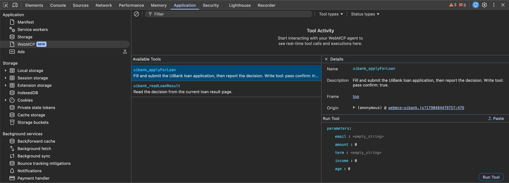
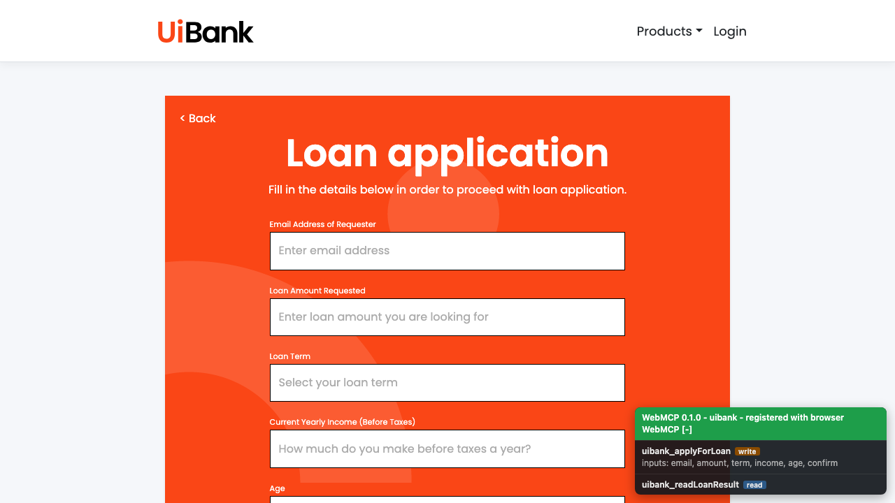
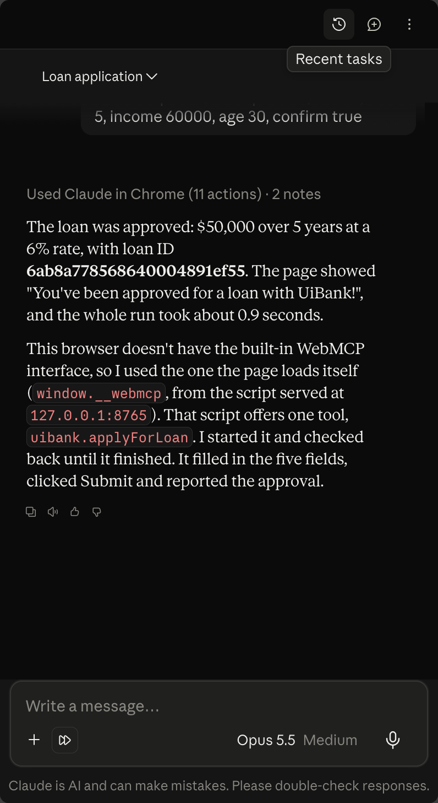
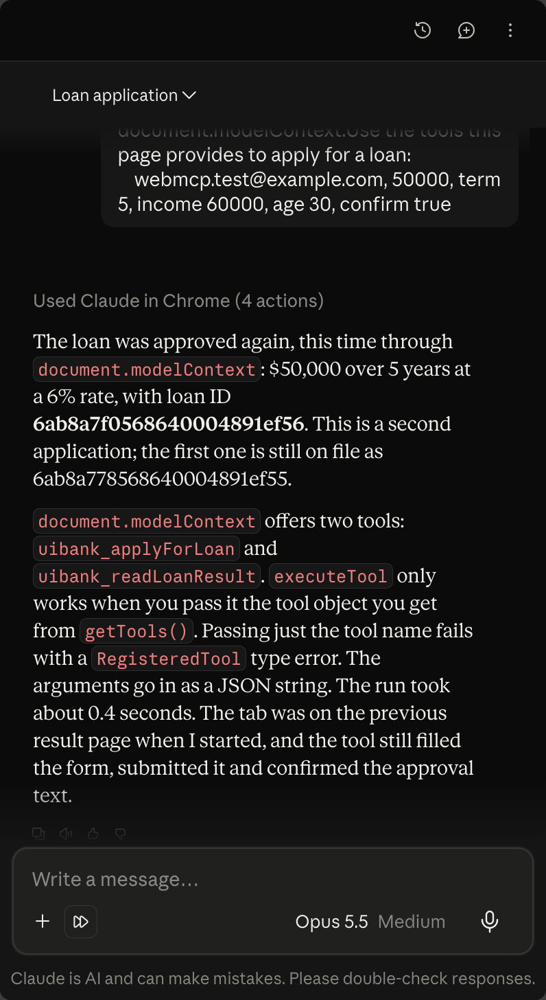
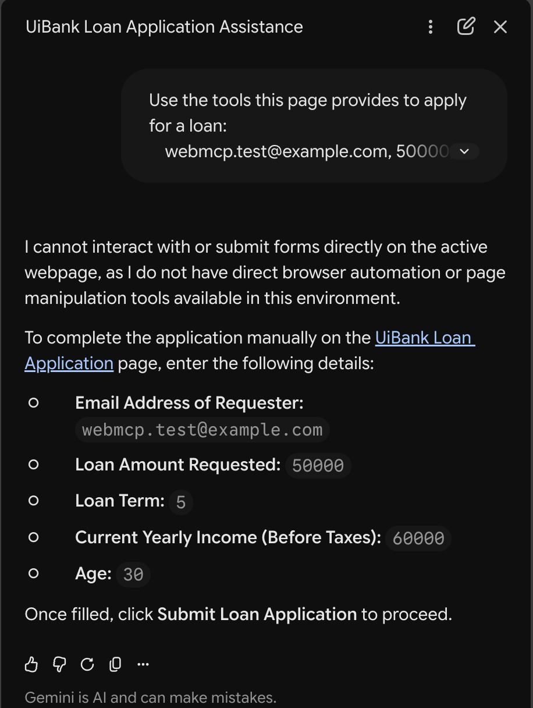
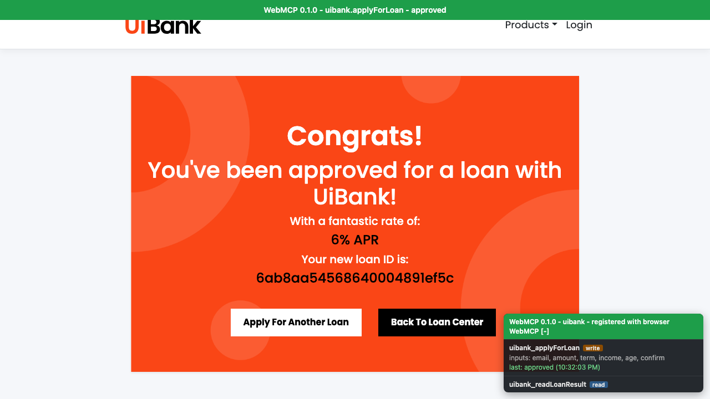
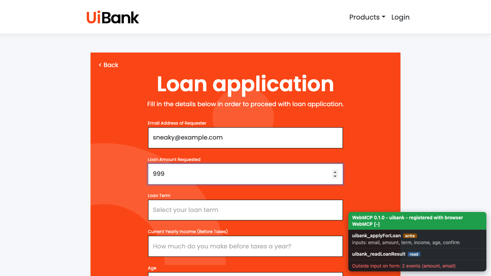

# WebMCP evidence - UiBank

Recorded 26.09.2026, Chrome 154 with `#enable-webmcp-testing` and `#devtools-webmcp-support`.

## 1. Chrome DevTools sees the injected tools

Chrome DevTools > Application > **WebMCP** (new panel) lists the tools the page registered with the browser's native WebMCP API:

- **Available Tools:** `uibank_applyForLoan` and `uibank_readLoanResult`, with the descriptions from `manifests/uibank.manifest.json`.
- **Details:** frame `top`; origin `webmcp-uibank.js` - the tools come from our injected bundle, not from UiBank. UiBank itself has no WebMCP.
- **Run Tool:** DevTools builds an input form from the tool's schema (email, amount, term, income, age, ...) and can call the tool directly.
- **Tool Activity:** shows tool calls live when an agent uses them.

## 2. On-page tools panel - before a call

Bottom right: the adapter's tools panel. "registered with browser WebMCP" means the native registration succeeded. The write tool lists `confirm` as a required input.

## 3. On-page tools panel - after a call

The tool was called through `document.modelContext.executeTool` (native WebMCP). Green banner at the top: tool and outcome. Panel: "last call ok - result: approved" with time. The page shows the approved loan with rate and loan ID.

## 4. An AI agent finds and uses the tools on its own

Claude in Chrome (side panel, Opus 5.5) was only given the task "Use the tools this page provides to apply for a loan: ...". It discovered the injected adapter (`window.__webmcp`), called `uibank.applyForLoan` via start/poll and reported: approved, 6%, loan ID, ~0.9 s. No clicking or typing by the agent.

Note: it looked for the draft location `navigator.modelContext`, missed Chrome 154's `document.modelContext`, and therefore used the adapter's own bridge instead of native WebMCP - same tool, different route.

### 4b. Same agent, native WebMCP route

Prompt prefixed with a hint that the tools are at `document.modelContext`. The agent listed both tools via `getTools()`, called `uibank_applyForLoan` via `executeTool` (tool object + JSON string arguments - it found this contract itself) and reported: approved, 6%, new loan ID, ~0.4 s. Start the demo on the form page: a full page reload mid-call ends a native call, and without Playwright the runtime is not re-injected after a reload.

## 5. Contrast: Gemini in Chrome without tool support

Same prompt in Gemini in Chrome 154 (Flash): it sees no page tools and tells the user to fill in the form manually.

## 6. Proof that only the WebMCP tool changed the form

The runtime audits every manifest form. It separates the tool's own input from everything else:

- real keyboard/mouse input (`isTrusted` events - a person, or an agent's click/type actions),
- synthetic events from other scripts,
- values set by script without any event (compared with the last legit value, checked every 250 ms and right before filling/submitting).

The audit is frozen right before submit and returned with every job (`audit.clean`, `audit.outsideInputs`). Every spec asserts `audit.clean === true`, so the proof lands in Test Manager with each run.

Clean run - panel: "Form input: only by WebMCP tool":

Outside input - someone typed into amount and a script silently set email; panel lists both before the tool is even called:

**Verifying an agent (e.g. Claude in Chrome):** inject the bundle first, then give the agent the task. After the run: panel line green = the form was changed only through the tool; red = the agent (or anyone) also typed, clicked or wrote into the form. The job result from `executeTool` carries the same `audit` block. Complement with DevTools > WebMCP > Tool Activity (shows the call itself) and the agent's own action log.
